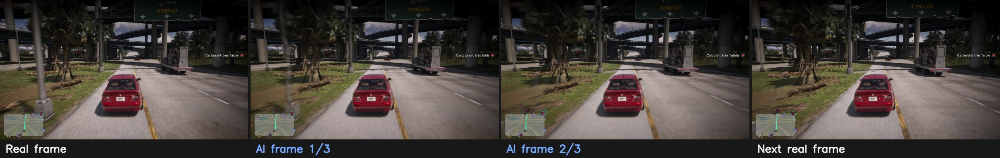
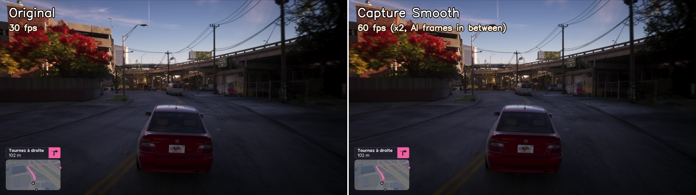

# Capture Smooth

Free, open-source frame generation for a **capture card feed**: plug a console into a capture card, and Capture Smooth shows it full screen on your PC with **AI-generated in-between frames** (RIFE 4.6). A 30 fps game becomes 60 or 90 fps, and a 60 fps game becomes 120 fps, with low added latency.

**▶ [See the before/after videos](https://d3ita.github.io/capture-smooth/)** · **[Download for Windows](../../releases/latest)** · *[Version française plus bas.](#français)*

[](https://d3ita.github.io/capture-smooth/)

*Two consecutive real frames from a 30 fps game, and the two frames Capture Smooth generates between them (x3 → 90 fps).*

[](https://d3ita.github.io/capture-smooth/)

> Not affiliated with Sony, Microsoft, Nintendo, Elgato, Rockstar Games or NVIDIA. Product names are only used to describe compatibility. Gameplay footage: Grand Theft Auto VI © Rockstar Games, shown only to demonstrate the software.

## What it does

```
console ──HDMI──> capture card ──USB──> PC: capture → duplicate-frame detection → RIFE (GPU) → display
                                                                 └── sound passthrough ──> speakers
```

- **Frame interpolation with RIFE 4.6.** It works on any video, because it needs no game engine data (DLSS 3 does).
- **Duplicate detection.** A 30 fps game in a 60 Hz signal sends every frame twice. The copies are ignored, so in-between frames are only made between real game frames.
- **Low latency.** Frames are paced evenly, late frames are dropped, and nothing waits in a queue. If the card cannot keep up with ×3, it switches to an even ×2 by itself.
- **Clean picture.** Scene cuts are shown directly instead of a ghostly blend, HUD elements that do not move (minimap, text) are kept from the real frame, and an adjustable contrast-adaptive sharpening (like AMD CAS / NVIDIA NIS) makes the picture crisper without halos.
- **Two engines:**
  - **CUDA** (PyTorch, NVIDIA): one CUDA graph per in-between frame, and the flow is estimated at half resolution with only the final warp at full resolution.
  - **DirectML** (ONNX Runtime): works on any DirectX 12 GPU (AMD, Intel, NVIDIA).
- **Borderless window** on the main screen. It doesn't flash when you click on another monitor, and it hides the taskbar while running.
- **Sound** from the capture card is played on your default speakers, with an optional delay. Press **M** to mute.
- **On-screen counter** (**F1**): displayed fps, game fps, AI time and added latency.

## Measured (RTX 4070 SUPER, 2560×1440 capture)

| Game | Mode | Displayed | AI per frame | Added latency |
|---|---|---|---|---|
| 30 fps | x3, CUDA | 90 fps | ~7 ms | ~32 ms |
| 30 fps | x2, CUDA | 60 fps | ~7 ms | ~26 ms |
| 60 fps | x2, CUDA | 120 fps | ~8 ms | ~19 ms |
| 30 fps | x3, DirectML | 90 fps | ~15 ms | ~45 ms |

The added latency is mostly unavoidable. An in-between frame needs the *next* real frame, and the real frame is shown after its in-betweens. At 30 fps with x3, that alone accounts for 22 ms.

## Download

Get the latest [release](../../releases):

- **NVIDIA** (fastest): for GeForce **RTX 20, 30, 40 and 50** series and **GTX 16** series, with a recent driver. It also contains the DirectML engine and switches to it by itself on any other card. CUDA is included, so the installer is large and comes in **3 files**: put `CaptureSmooth-<version>-NVIDIA-Setup.exe` and its two `.bin` files in the same folder, then run the Setup.exe.
- **DirectML**: a single ~100 MB `Setup.exe`, for any DirectX 12 graphics card (AMD Radeon, Intel Arc, older NVIDIA such as the GTX 10 series).

The installers need no administrator rights, add Start menu and desktop shortcuts, and uninstall from Windows settings.

> **"Windows protected your PC"?** The exe is not code-signed (a certificate costs money), so Windows SmartScreen warns about it the first time. Click **More info → Run anyway**. The full source code is in this repository.

Then open **Capture Smooth** from the Start menu or the desktop. A settings window opens. Choose:

- your console's output resolution (1440p or 4K, or 1080p),
- the game's frame rate (30 or 60 fps),
- smoothness or latency, sound, and the counter.

Then press **Lancer**. Your choice is remembered. Options passed on the command line (below) skip the window.

| Console output | Game | Smoothness first | Latency first |
|---|---|---|---|
| 1440p or 4K | 30 fps | 90 fps | 60 fps |
| 1440p or 4K | 60 fps | 120 fps | 120 fps |
| 1080p | 30 fps | 90 fps | 60 fps |
| 1080p | 60 fps | 120 fps | 120 fps |

**Keys:** Esc quit · Space interpolation on/off · 2 / 3 / 4 multiplier · S sharpening · H HUD protection · F1 or I counter · M sound · F sharp/bilinear scaling · C BT.709/BT.601 colours · D time of each stage

## Without a capture card: PS Remote Play

Capture Smooth can also take the picture from the official **PS Remote Play** app instead of a capture card: choose **PS Remote Play (sans boîtier)** in the settings window, or start with `--source remoteplay`.

- **More latency.** Remote Play compresses the picture on the PS5, sends it over the network and decompresses it on the PC: usually **50 to 100 ms more** than a capture card, on top of Capture Smooth's own delay.
- **Lower picture quality**: the stream is compressed and at most 1080p, and compression blocks can show more in AI frames.
- Start PS Remote Play and show your game first, and keep its window open (not minimized). Capture Smooth shows on top of it without taking the focus, so the controller keeps working in Remote Play. The sound comes from Remote Play.

A capture card stays the recommended way.

## Setup tips

1. **Close OBS and your capture card's software** before starting, because they lock the device.
2. **The capture card cannot upscale.** If you ask for 1440p while the console sends 1080p, you get a black screen or the card's "invalid resolution" picture. Pick the resolution the console really outputs. A 4K output works with the "1440p or 4K" choice, because the card downscales it.
3. **The console only offers resolutions supported by the screen on the card's HDMI passthrough.** If 1440p is refused, set the card's **EDID** to *internal* in its software, or plug a 1440p/4K screen into the passthrough.
4. **HDR off** on the console.
5. **G-Sync / FreeSync**: enable it for windowed mode too (NVIDIA Control Panel → Set up G-SYNC → windowed and full screen mode).
6. If the sound comes before the picture, start the exe with `--audio-delay 30` (in ms).

## Options

```
--res 1080p|1440p|4k     capture resolution (4K is reduced to 1440p before the AI)
--fps 30|60              capture frame rate
--x 2|3|4                frame multiplier (x3 is the useful maximum for 30 fps games)
--source capture|remoteplay   capture card (default) or the PS Remote Play window
--window "title"         window to capture with --source remoteplay (default "PS Remote Play")
--device auto|"name"|N   capture device (--list shows them)
--moteur auto|cuda|directml
--quality rapide|normal  normal = flow at full resolution (sharper, twice slower; 1080p only)
--mode sans-bordure|plein-ecran|fenetre
--vsync                  no tearing without G-Sync (adds latency)
--nettete 0-100           sharpening strength (default 30, S toggles it)
--no-hud                 no HUD protection (H toggles it)
--no-cut                 interpolate across scene cuts too
--bilineaire             old, softer scaling to the screen (F toggles it)
--couleurs auto|709|601  capture colour matrix (C toggles it)
--capture auto|brute|opencv   brute = the card read raw (NV12/YUY2) by FFmpeg, colours converted on the GPU:
                         about one CPU core less (NVIDIA build; auto = brute when possible, else opencv)
--plage auto|limitee|pleine   colour range for raw capture (auto = what the card reports, else limited)
--mesures                time of each stage in the counter and the log (D toggles it)
--audio-delay MS, --no-audio
--test                   animated test picture instead of the capture card
--show-taskbar           shows the taskbar again if the app was killed
```

## Run from source

Windows 10/11 and Python 3.11+.

```
pip install numpy opencv-python-headless glfw PyOpenGL sounddevice comtypes av windows-capture
pip install torch --index-url https://download.pytorch.org/whl/cu128     # CUDA engine (RTX 20 to RTX 50)
pip install onnxruntime-directml                                         # or the DirectML engine
python smooth.py --res 1440p --x 3
```

- `tools/export_onnx.py` rebuilds the ONNX models from `models/flownet_v4.6.pkl`.
- `build.ps1` builds both releases with PyInstaller.

---

## Français

Génération d'images gratuite et open source pour un **boîtier de capture** : branche ta console sur un boîtier de capture, et Capture Smooth l'affiche en plein écran sur ton PC en ajoutant des **images intermédiaires créées par IA** (RIFE 4.6). Un jeu à 30 fps passe à 60 ou 90 fps, un jeu à 60 fps passe à 120 fps, avec peu de retard ajouté.

**Installation :** télécharge la [release](../../releases).

- **NVIDIA** : la plus rapide, pour les GeForce **RTX 20, 30, 40 et 50** et **GTX 16**. Sur une autre carte, elle passe toute seule au moteur DirectML. L'installateur fait **3 fichiers** : mets le `Setup.exe` et ses deux `.bin` dans le même dossier, puis lance le `Setup.exe`.
- **DirectML** : un seul `Setup.exe` d'environ 100 Mo, pour toutes les cartes graphiques (AMD Radeon, Intel Arc, anciennes NVIDIA comme les GTX 10).

> **« Windows a protégé votre ordinateur » ?** L'exe n'est pas signé (un certificat est payant), donc Windows SmartScreen prévient au premier lancement. Clique sur **Informations complémentaires → Exécuter quand même**. Tout le code source est dans ce dépôt.

Ensuite, ouvre **Capture Smooth** depuis le menu Démarrer ou le Bureau. Une fenêtre de réglages s'ouvre : choisis la sortie vidéo de la console, les fps du jeu, la fluidité ou la latence, puis clique sur **Lancer**. Tes choix sont mémorisés.

**Touches :** Échap quitter · Espace interpolation on/off · 2/3/4 multiplicateur · S netteté · H protection du HUD · F1 ou I compteur · M son · F mise à l'échelle fine/bilinéaire · C couleurs BT.709/BT.601 · D temps de chaque étape

**Sans boîtier de capture :** choisis **PS Remote Play (sans boîtier)** dans la fenêtre de réglages. Attention : **plus de latence** (50 à 100 ms de plus qu'avec un boîtier, à cause de la compression et du réseau) et image compressée, en 1080p au maximum. Lance PS Remote Play et affiche ton jeu avant, et garde sa fenêtre ouverte (pas réduite). La manette reste active dans Remote Play, et le son vient de Remote Play.

**À savoir :**

- **Ferme OBS** et le logiciel du boîtier avant de lancer.
- **Le boîtier ne peut pas agrandir l'image.** Choisis la résolution que la console envoie vraiment. En 4K, choisis « 1440p ou 4K » : le boîtier réduit l'image.
- **Si la console refuse le 1440p** (« ton écran ne le prend pas en charge ») : dans le logiciel du boîtier, mets l'**EDID** sur *interne*, puis débranche et rebranche la console.
- **HDR désactivé** sur la console.
- **G-Sync** : active-le aussi pour le mode fenêtré.
- **Capture brute** (version NVIDIA) : le boîtier est lu sans conversion par le processeur, et les couleurs sont converties sur la carte graphique (environ un cœur de processeur libéré). Si ça ne marche pas avec ton boîtier, l'app revient toute seule à l'ancienne méthode ; tu peux aussi la forcer avec `--capture opencv`.
- **Barre des tâches :** l'appli la cache pendant qu'elle tourne. Si elle reste cachée après un plantage, lance `Reafficher la barre des taches.cmd`.

## Credits and licences

- Code: [MIT](LICENSE).
- RIFE by hzwer et al. ([Practical-RIFE](https://github.com/hzwer/Practical-RIFE), MIT). The 4.6 weights come from [vs-rife](https://github.com/HolyWu/vs-rife) (MIT).
- Other components are listed in [THIRD_PARTY.md](THIRD_PARTY.md).
